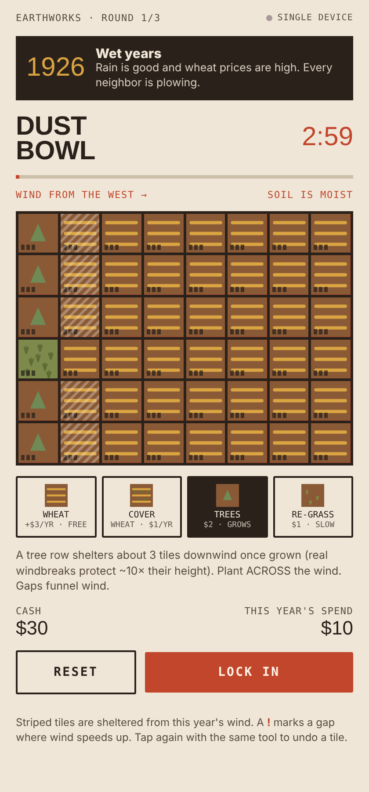
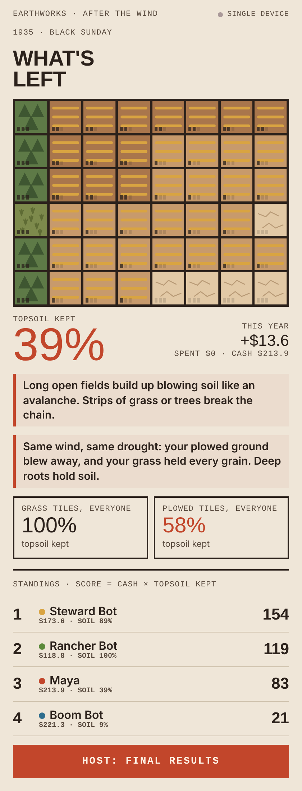
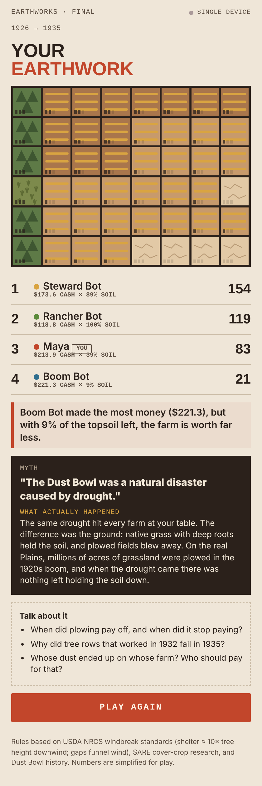

# EARTHWORKS · Dust Bowl

A 5-minute multiplayer microlearning game about land use. Each player runs a small farm on the Great Plains across three short rounds (**1926 wet years → 1932 drought → 1935 Black Sunday**) and decides how much to plow, where to plant tree rows, and when to use cover crops. Then the wind hits every farm at once.

**Score = cash × share of topsoil kept.** Plowing everything earns the most money and still loses.

| Build | After the wind | Final |
|---|---|---|
|  |  |  |

## Play

Open `index.html` in any browser. With no server it runs in **solo mode against three bots**:

- **Boom Bot** plows everything
- **Steward Bot** plants tree rows across the wind
- **Rancher Bot** never plows

Live multiplayer (room codes, hosts, shared rounds) uses the Claude artifacts `room` capability, so it only works when the page is opened as a Claude artifact. A standalone multiplayer server (WebSocket rooms joinable by code) is the next step.

## What it teaches

The rules come from real science, simplified for play:

| Rule in the game | Based on |
|---|---|
| A tree row shelters ~3 tiles downwind and a little upwind | USDA NRCS windbreak standard: protection ≈ 10× tree height downwind, 2× upwind |
| Gaps in a tree row speed the wind up | NRCS / UNL Extension: gaps funnel and accelerate wind |
| Tree rows must run *across* the wind (Black Sunday comes from the north) | NRCS: windbreaks are planted perpendicular to prevailing winds |
| Cover crops cut erosion a lot, not to zero, and use water in a drought | SARE cover-crop research (31–100% less soil loss) |
| Native grass holds soil; plowed ground blows | Dust Bowl history: deep-rooted prairie was plowed in the 1920s boom |
| Long open fields erode worse downwind | Wind-erosion "avalanching" across unbroken fields |
| Your dust lands on the next farm downwind | Erosion as a shared, off-site cost |

It ends with a myth card ("The Dust Bowl was a natural disaster caused by drought") built from the table's own results, plus discussion questions. It is aimed at NGSS MS-ESS3-3 (human impacts on Earth systems), and works for adults too.

## Project layout

```
index.html          the built, self-contained game (open this)
src/engine.js       deterministic game rules: wind, shelter, erosion, scoring, bots
src/app.html        UI and multiplayer (engine is inlined at build time)
build.js            node build.js  → regenerates index.html
tests/tune.js       balance check: runs every strategy and prints scores
tests/test_solo.js  Playwright solo playthrough with screenshots
tests/test_mp.js    Playwright two-player test using tests/mock-room.js
```

```bash
node build.js            # rebuild index.html after editing src/
node tests/tune.js       # check game balance
node tests/test_solo.js  # needs playwright
```

## Multiplayer design

Host-authoritative. The host's page runs the game and broadcasts the full state (phase, round, timer, every farm). Players send only their plan for the round. The engine is deterministic, so every device replays the same wind animation and gets the same results.

---

Part of **EARTHWORKS**, a series of land-use mini games: Dust Bowl, Wildfire Line, King Tide, Upstream / Downstream, Seed Drop, The Commons.
