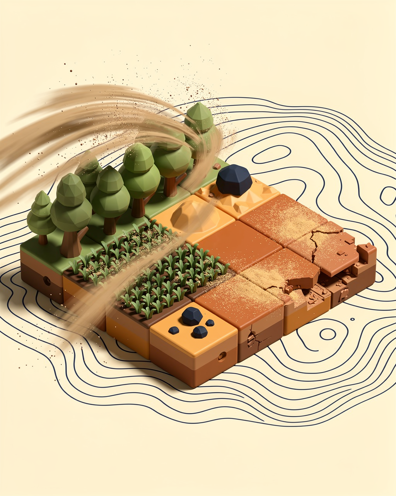
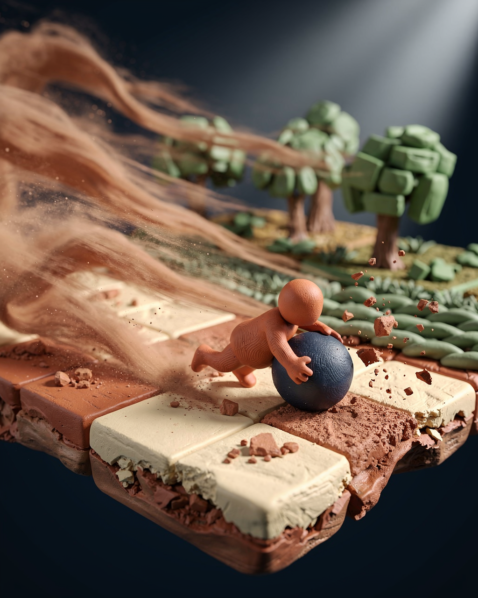
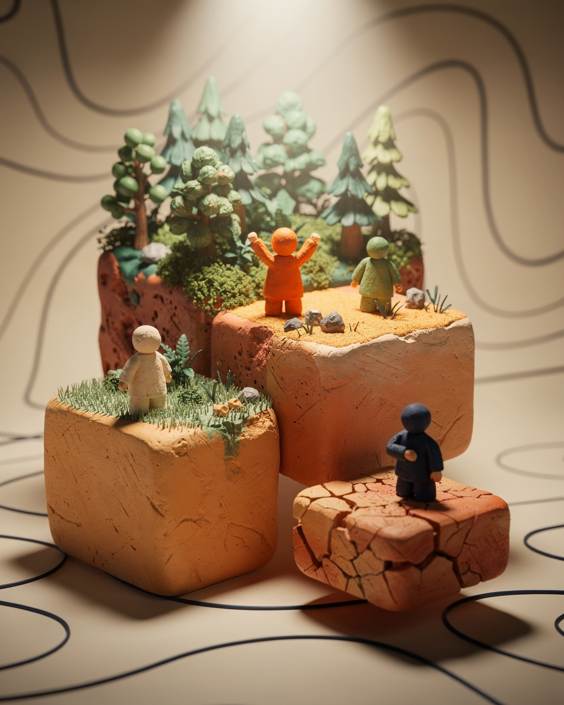
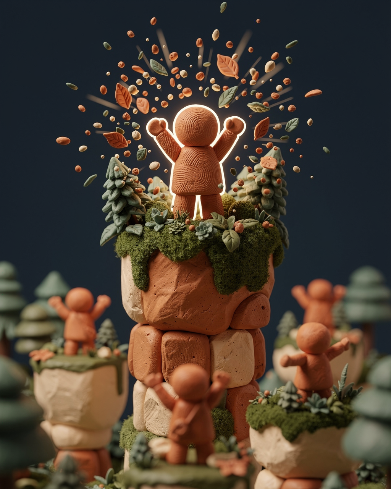
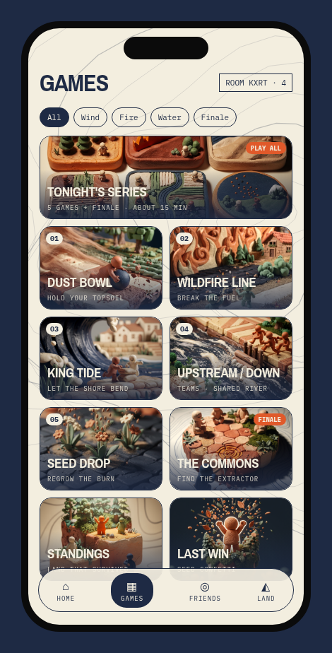
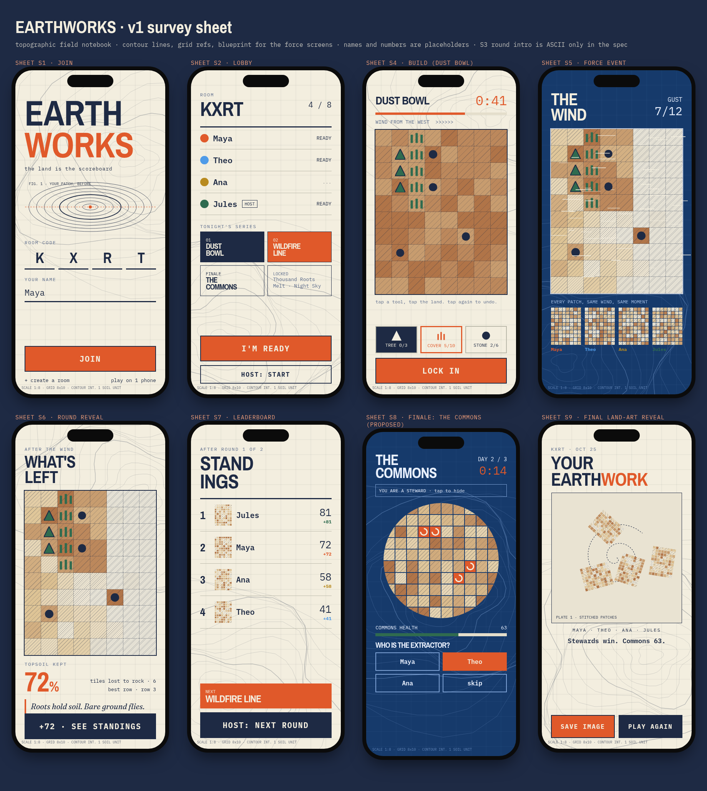

# EARTHWORKS: Dust Bowl Reference Images

These are AI-generated (FLUX) clay-style 3D concept images for EARTHWORKS: Dust Bowl, meant as visual reference only, not final art. The palette is the survey sheet look: cream paper, contour lines, navy blueprint, burnt orange, terracotta, plus moss and forest greens, with no neon.

## Dust Bowl

### dust_bowl_diorama.png

Wide view of the Dust Bowl arena with clay-style diorama aesthetic

### dust_bowl_mid_action.png

Mid-action gameplay moment showing the Dust Bowl environment

## Scoreboard

### 07_scoreboard_podium.png

Scoreboard podium display with clay-style 3D rendering

### 08_scoreboard_seed_confetti.png

Scoreboard celebrating with seed confetti effect

## Style Reference

### games_tab.png

Games tab UI showing the survey sheet aesthetic and color palette

### survey_sheet_ui.png

Survey sheet UI reference with cream paper and contour line style
